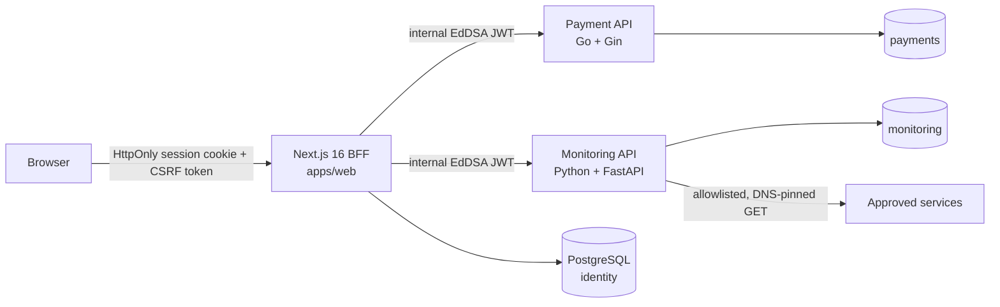

# ZestOps

**Secure Financial Operations & Service Monitoring Platform** — a portfolio project that
demonstrates full-stack engineering, application security, and DevOps across three
languages.

[](https://github.com/copcrush/zestops/actions/workflows/ci.yml)
[](https://github.com/copcrush/zestops/actions/workflows/security.yml)
[](https://github.com/copcrush/zestops/actions/workflows/codeql.yml)

> ⚠️ All payments are **simulated**. ZestOps has no payment gateway and must never hold
> real financial or personal data.

## What it does

1. Users sign in (admin or viewer).
2. Admins create **simulated payments**; the Go Payment API validates them, stores them in
   PostgreSQL **exactly once** (idempotency keys) and runs them through an authorized
   simulation workflow (`pending → processing → succeeded | failed`, or `cancelled`).
3. The Python Monitoring API runs **SSRF-safe health checks** of approved services, keeps
   history and uptime, and opens incidents automatically when a service is down.
4. Admins investigate and resolve incidents; everyone sees the dashboard.

## Architecture



| Part | Tech | Highlights |
|---|---|---|
| `apps/web` | Next.js 16, React 19, TypeScript (strict), Tailwind CSS 4, Zod | BFF auth (argon2id, server-side sessions, lockout, rate limit, CSRF, audit log), nonce-based CSP, accessible responsive UI |
| `services/payment-api` | Go, Gin, pgx, slog | idempotency keys + fingerprints, row-locked state machine, append-only history, keyset pagination, concurrency tests |
| `services/monitoring-api` | Python 3.13, FastAPI, SQLAlchemy 2 async, httpx | SSRF defenses (allowlist, IP policy, DNS pinning, redirect/size/time/concurrency limits), incident workflow |
| `infra/database` | PostgreSQL 17 | schema + least-privilege role per service, versioned SQL migrations, labelled demo seeds |
| `.github/workflows` | GitHub Actions | lint, types, unit/integration/E2E tests, gitleaks, audits, CodeQL, SHA-pinned actions |

More: [Architecture overview](docs/architecture/OVERVIEW.md) ·
[Auth](docs/architecture/AUTH.md) · [Data flow](docs/architecture/DATA_FLOW.md) ·
[Project structure](docs/architecture/PROJECT_STRUCTURE.md) · [Glossary](docs/architecture/GLOSSARY.md) ·
[ADRs](docs/adr/README.md)

## Quick start (Windows or macOS)

Requirements: Git, Docker Desktop, Node.js 22. Details: [docs/LOCAL_SETUP.md](docs/LOCAL_SETUP.md).

```bash
git clone https://github.com/copcrush/zestops.git
```

```bash
cd zestops
```

```bash
node scripts/setup-local-env.mjs
```

```bash
docker compose up -d --build
```

```bash
cd apps/web && npm install && npm run dev
```

Open http://localhost:3000 and sign in with `admin@zestops.demo` / `LocalAdmin#2026`
(or `viewer@zestops.demo` / `LocalViewer#2026`). These demo accounts exist only in your
local database.

## Testing

```bash
cd apps/web && npm run lint && npm run typecheck && npm test && npm run test:e2e
```

```bash
cd services/payment-api && go test -race ./...
```

```bash
cd services/monitoring-api && uv run ruff check . && uv run mypy && uv run pytest
```

What is covered and why: [docs/TESTING.md](docs/TESTING.md).

## Security

- [Threat model (STRIDE)](docs/security/THREAT_MODEL.md)
- [Security checklist (OWASP Top 10 / ASVS)](docs/security/SECURITY_CHECKLIST.md)
- [Security test plan](docs/security/SECURITY_TEST_PLAN.md)

This project applies practical defenses and tests them, but it is **not** security-certified
and makes no claim of being fully secure.

## Operations

- [Debugging runbook](docs/runbooks/DEBUGGING.md)
- [Deployment](docs/runbooks/DEPLOYMENT.md) · [Rollback](docs/runbooks/ROLLBACK.md)
- [API error format](docs/api/ERRORS.md)
- [Known limitations](docs/KNOWN_LIMITATIONS.md)

## How this project was built

ZestOps follows an **AI-executed, human-directed** model: an AI engineering agent
(Claude Code) implemented, tested and documented the system under the rules in
[`CLAUDE.md`](CLAUDE.md), while the owner made the product and architecture decisions
recorded in [`docs/adr`](docs/adr/README.md) and performs user acceptance testing.
