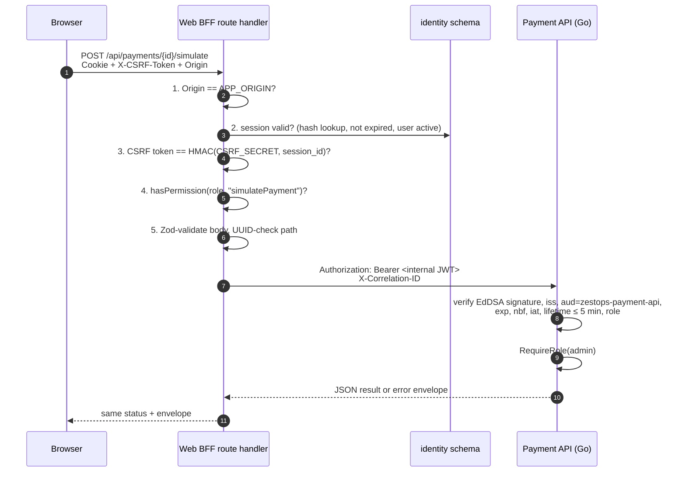

# Authentication & Authorization

ZestOps uses **application-managed authentication with a Backend-for-Frontend**
(decision: [ADR-0002](../adr/0002-authentication-bff-sessions-internal-jwt.md)).

## Roles (RBAC)

| Action | admin | viewer |
|---|:-:|:-:|
| View dashboard, payments, monitoring, incidents | ✅ | ✅ |
| Create payments, simulate success/failure, cancel | ✅ | ❌ |
| Register / enable / disable monitored services, run checks | ✅ | ❌ |
| Report, investigate, annotate, resolve incidents | ✅ | ❌ |
| View the security audit log (`/audit`) | ✅ | ❌ |
| Change own display name / password, sign out other sessions | ✅ | ✅ |

The permission map lives in `apps/web/src/features/auth/permissions.ts` (UI + BFF)
and is enforced again in each backend (`RequireRole` in Go, `AdminPrincipal` in Python).

## Public guest demo

If `PUBLIC_DEMO_VIEWER_EMAIL` is set, the login page shows **Explore as guest
(read-only)**. `POST /api/auth/demo` (same-origin only, rate-limited per IP) starts a normal
server-side session for that account **only if its role is `viewer`**. The shared guest
account cannot change its display name or password, and cannot sign out other sessions
(`403 DEMO_ACCOUNT_READ_ONLY`), so one visitor cannot lock out the others. Guests only see
their own session in Settings. Code: `apps/web/src/features/auth/server/demo-access.ts`.

## Login flow

```mermaid
sequenceDiagram
    autonumber
    participant B as Browser
    participant W as Web BFF (/api/auth/login)
    participant DB as PostgreSQL (identity)
    B->>W: POST {email, password} (Origin: app)
    W->>W: Origin check (login CSRF), Zod validation
    W->>DB: consume rate limit bucket (per IP, 15 min window)
    W->>DB: SELECT user by lower(email)
    W->>W: argon2id verify (dummy verify if user unknown → same timing)
    alt wrong password
        W->>DB: atomic UPDATE failed_login_count / locked_until (lock after 5)
        W->>DB: INSERT audit_events (login_failed / account_locked)
        W-->>B: 401 INVALID_CREDENTIALS (generic message)
    else success
        W->>DB: reset counters, INSERT session (SHA-256 of a random 256-bit token)
        W->>DB: INSERT audit_events (login_succeeded)
        W-->>B: 200 + Set-Cookie: __Host-zestops_session=<token>; HttpOnly; Secure; SameSite=Lax
    end
```

### Session properties

- Opaque random token (32 bytes, base64url) in an **HttpOnly** cookie; JavaScript
  cannot read it, so XSS cannot steal it directly.
- Production cookie name uses the `__Host-` prefix (Secure, Path=/, no Domain).
- The database stores only `sha256(token)`; a DB leak does not reveal usable tokens.
- **Idle timeout** (default 30 min, sliding) and **absolute timeout** (default 8 h).
- Logout deletes the row → immediate revocation. Password change revokes all other
  sessions. Users can sign out other sessions in Settings.
- Disabled users (`is_active = false`) lose access on their next request.

## Request authorization (BFF → backends)



### Internal JWT

| Claim | Value |
|---|---|
| `alg` (header) | `EdDSA` (Ed25519). Backends reject every other algorithm (incl. `none`, `HS256`) |
| `kid` (header) | `INTERNAL_JWT_KEY_ID` (supports future key rotation) |
| `iss` | `zestops-web` |
| `aud` | `zestops-payment-api` **or** `zestops-monitoring-api` (a token for one cannot be replayed at the other) |
| `sub` | user UUID (taken from the server-side session, never from the browser) |
| `role` | `admin` / `viewer` |
| `iat`, `nbf`, `exp` | lifetime 60 s (backends accept at most 5 min, 30 s clock leeway) |
| `jti` | random UUID |

Only the web app has the **private** key (`INTERNAL_JWT_PRIVATE_KEY_BASE64`).
Backends have the **public** key (`INTERNAL_JWT_PUBLIC_KEY_BASE64`), so a compromised
backend cannot mint tokens for the other one.

## CSRF protection

State-changing requests need **all** of:

1. `SameSite=Lax` session cookie (not sent on cross-site POSTs by browsers).
2. `Origin` header equal to `APP_ORIGIN` (or `Sec-Fetch-Site: same-origin`).
3. `X-CSRF-Token` = `HMAC-SHA256(CSRF_SECRET, "csrf:" + session_id)`, compared in
   constant time. The token is delivered to the page by the server (React context)
   and is useless without the session.

The login endpoint has no session yet, so it relies on the Origin check (login CSRF).

## Pages

- `src/proxy.ts` only redirects when **no** session cookie exists (fast UX path).
- Every page calls `requireSession()` / `requirePermission()` (Data Access Layer), which
  validates the session in the database. Layouts alone are not trusted because they do
  not re-run on every client-side navigation.
- Admin-only page: `/audit` → viewers are redirected to `/unauthorized` (403 page).

## Where the code is

| Concern | File |
|---|---|
| Login logic, lockout | `apps/web/src/features/auth/server/login.ts` |
| Sessions | `apps/web/src/features/auth/server/session.ts` |
| CSRF | `apps/web/src/features/auth/server/csrf.ts` |
| Route wrapper (origin, session, CSRF, RBAC) | `apps/web/src/lib/server/route-handler.ts` |
| Internal JWT signing | `apps/web/src/lib/server/internal-token.ts` |
| Go verification + RBAC | `services/payment-api/internal/auth/token.go`, `internal/middleware/authentication.go` |
| Python verification + RBAC | `services/monitoring-api/app/security/auth.py`, `app/api/dependencies.py` |

## Tests

- Go: `internal/auth/token_test.go` (alg none, HS256 confusion, RS256, wrong aud/iss,
  expired, long lifetime, tampered…), `tests/integration` (401/403 per route).
- Python: `tests/test_auth.py`, `tests/test_api_*.py`.
- Web: `tests/unit/security-helpers.test.ts`, `tests/integration/auth.test.ts`
  (lockout, rate limit, session expiry, hashing), `tests/e2e/auth.spec.ts`,
  `tests/e2e/rbac.spec.ts`.
