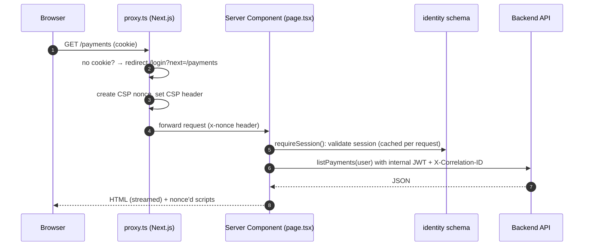
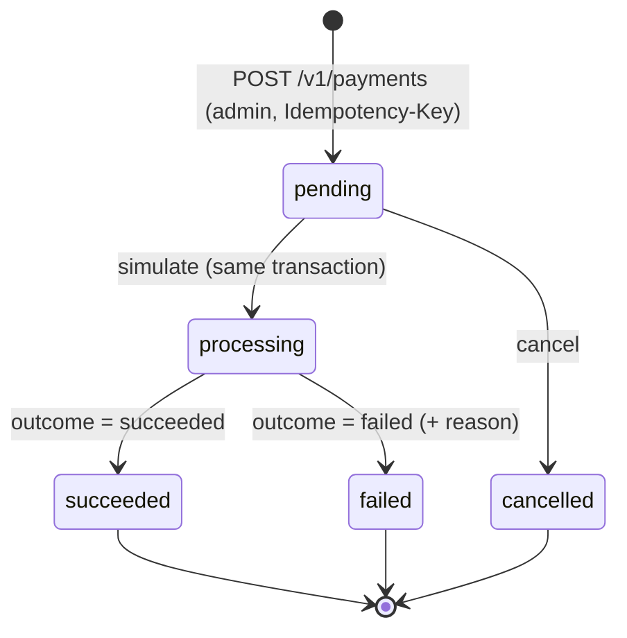
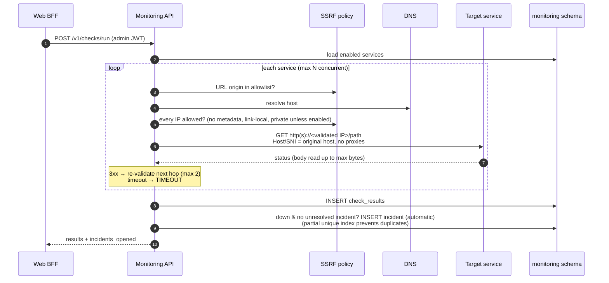
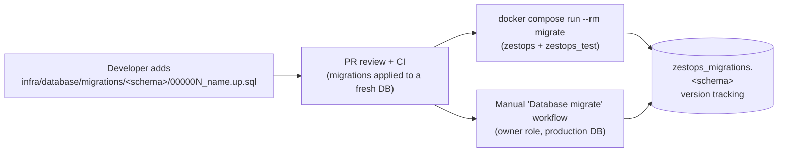

# Data Flow

How a request travels through ZestOps, step by step.

## 1. Request lifecycle (any page)

- `loading.tsx` shows a skeleton immediately while the server loads data.
- If a backend is down, the page shows an inline error state for that section
  (`Promise.allSettled` + `describeBackendFailure`) instead of failing the whole page.
- Unexpected errors are caught by `error.tsx` (safe message + digest, no stack trace).

## 2. Payment flow

**Create (idempotent):**

1. The browser form generates a random `idempotency_key` once per opened form.
2. BFF validates (Zod), checks `createPayment` permission, forwards with
   `Idempotency-Key` header.
3. Go handler strictly decodes JSON (unknown fields, floats-as-integers rejected) and validates.
4. Service computes a SHA-256 **fingerprint** of the business fields, then in one transaction:
   `INSERT ... ON CONFLICT (created_by, idempotency_key) DO NOTHING RETURNING ...`
   - new row → insert `payment_events` (null → pending) → **201**
   - existing row, same fingerprint → **200** + `Idempotent-Replayed: true`
   - existing row, different fingerprint → **422 IDEMPOTENCY_KEY_REUSED**
5. Concurrent identical requests: PostgreSQL makes the second INSERT wait on the unique
   index until the first commits, so exactly one payment is created
   (tested with 25 parallel requests).

**Simulate / cancel:** one transaction with `SELECT ... FOR UPDATE` (row lock), state
machine check (`CanTransitionTo`), status update, and append-only history rows. Twenty
parallel simulations settle a payment exactly once (tested; removing the lock makes the
test fail).

## 3. Monitoring flow

Check outcome rules: expected status and fast → `up`; expected status but slower than
`degraded_threshold_ms` → `degraded` (`SLOW_RESPONSE`); anything else → `down` with an
error code (`UNEXPECTED_STATUS`, `TIMEOUT`, `CONNECTION_FAILED`, `TARGET_BLOCKED`,
`REDIRECT_BLOCKED`, `TOO_MANY_REDIRECTS`, `RESPONSE_TOO_LARGE`, `DNS_RESOLUTION_FAILED`).

## 4. Incident flow

`open → investigating → resolved` (or `open → resolved`). Resolving requires a note.
Status changes lock the incident row, so two admins resolving at once produce one
success and one `409 INVALID_STATE_TRANSITION`. Every change is appended to
`incident_events` (timeline shown in the UI).

## 5. Database migration flow

- One-time per environment: `infra/database/bootstrap/bootstrap.sql` (schemas, roles, grants).
- Migrations run as the owner role; applications use roles without DDL rights.
- Only `up` and `version` are exposed by `scripts/migrate.sh`; never reset production.

## 6. Observability flow

- The BFF creates a **correlation ID** per request and sends `X-Correlation-ID` to backends.
- Each backend creates its own **request ID**, returns it as `X-Request-ID`, includes it
  in every error body, and logs both IDs in JSON (`request completed` lines).
- Unsafe incoming correlation IDs (newlines, > 64 chars) are replaced, preventing log injection.
- To trace a user report: take the `request_id` shown in the error → search logs of all
  services for the same `correlation_id` (see [DEBUGGING.md](../runbooks/DEBUGGING.md)).
