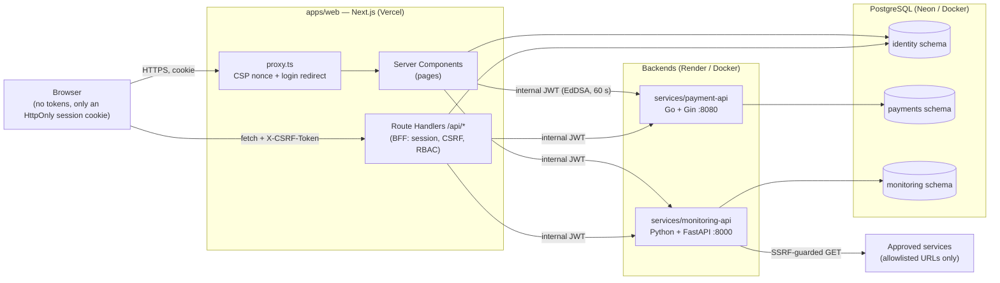
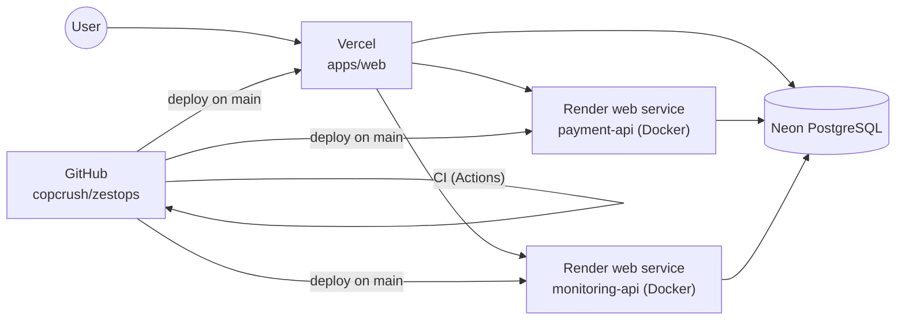

# Architecture Overview

ZestOps is a small, realistic platform made of three applications and one
PostgreSQL database. This page explains **what talks to what, and why**.
It is written for a developer who knows JavaScript but is new to Go and Python.

## System diagram

## Components

| Component | Responsibility | Owns data | Tech |
|---|---|---|---|
| Web app / BFF | UI, login, sessions, CSRF, RBAC checks, calling backends | `identity` (users, sessions, audit log, rate limits) | Next.js 16, React 19, TypeScript, Tailwind CSS 4, Zod, jose, pg |
| Payment API | Simulated payments: create (idempotent), list, details, simulate success/failure, cancel, summary | `payments` (currencies, payments, payment_events) | Go 1.26+, Gin, pgx, golang-jwt, slog |
| Monitoring API | Approved service registry, SSRF-safe health checks, check history, incidents, summary | `monitoring` (services, check_results, incidents, incident_events) | Python 3.13, FastAPI, SQLAlchemy 2 (async), asyncpg, httpx, PyJWT |
| PostgreSQL | Persistence, constraints, transactions, row locks | — | PostgreSQL 17 |

## Key design decisions

| Decision | Why | Record |
|---|---|---|
| Monorepo | One clone, atomic changes, one CI | [ADR-0001](../adr/0001-monorepo-structure.md) |
| BFF + server-side sessions + internal JWT | No tokens in the browser; backends verify a signed identity | [ADR-0002](../adr/0002-authentication-bff-sessions-internal-jwt.md) |
| One database, one schema + role per service | Ownership and least privilege on a single free-tier database | [ADR-0003](../adr/0003-database-schema-per-service.md) |
| Real PostgreSQL in tests | Locks, constraints and transactions are what we must verify | [ADR-0004](../adr/0004-testing-stack.md) |
| Integer minor units for money | No floating-point rounding errors | [ADR-0005](../adr/0005-money-as-integer-minor-units.md) |

## Trust boundaries

1. **Internet → Web app.** Everything from the browser is untrusted: validated with
   Zod, checked for session, CSRF token, same origin and role.
2. **Web app → Backends.** Backends trust only a valid internal JWT
   (signature, issuer, audience, expiry, lifetime ≤ 5 min, role). They re-check
   the role (RBAC) and re-validate every input. CORS is not enabled: browsers
   cannot call the backends directly with credentials.
3. **Monitoring API → Internet/intranet.** Outbound requests are the most dangerous
   feature (SSRF). Only allowlisted origins, safe IPs (DNS pinning), limited
   redirects, size, time and concurrency.
4. **Services → Database.** Each service uses its own least-privilege role that
   cannot touch other schemas or change the schema.

See [AUTH.md](AUTH.md), [DATA_FLOW.md](DATA_FLOW.md) and the
[threat model](../security/THREAT_MODEL.md).

## Deployment architecture (target)

Provider choices are confirmed with the owner before any public deployment
(see [DEPLOYMENT.md](../runbooks/DEPLOYMENT.md)).
