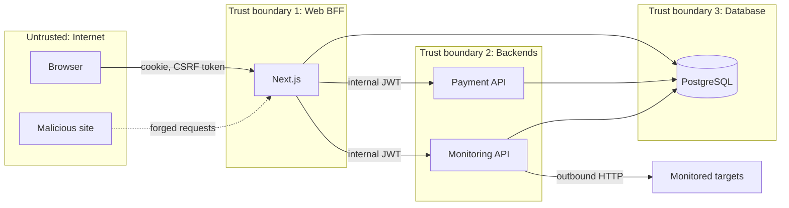

# Threat Model (STRIDE)

Scope: the ZestOps web app/BFF, Payment API, Monitoring API, PostgreSQL, and the
CI/CD pipeline. Method: STRIDE per component and data flow. This is a practical
portfolio threat model — it does **not** certify the system as secure.

Last reviewed: 2026-11-15.

## Assets

| Asset | Why it matters |
|---|---|
| User credentials (password hashes) | Account takeover, credential stuffing elsewhere |
| Session tokens (cookie) | Impersonation of a signed-in user |
| Internal JWT private key | Anyone holding it can act as any user on the backends |
| Payment records & history | Integrity of (simulated) financial data, audit trail |
| Incident data / monitoring config | Operational truth; monitoring config controls outbound requests |
| Database credentials | Direct data access |
| CI/CD secrets, deploy hooks | Supply-chain compromise |

## Actors

- **Anonymous internet user** — can reach the web app and (if deployed publicly) the backend URLs.
- **Viewer** — authenticated, read-only.
- **Admin** — authenticated, can create payments, run checks, manage incidents.
- **Malicious site** — tries CSRF / clickjacking against signed-in users.
- **Compromised dependency / CI action** — supply-chain attacker.

## Data-flow diagram with trust boundaries

## STRIDE analysis

| # | Threat (STRIDE) | Component | Scenario | Mitigations in ZestOps | Residual risk |
|---|---|---|---|---|---|
| S1 | **Spoofing** | Web login | Credential stuffing / brute force | argon2id hashes; per-IP rate limit (DB-backed, 20 / 15 min); account lockout after 5 failures for 15 min; generic errors; constant-ish timing for unknown users; audit events | No MFA (documented limitation); distributed attacks across many IPs can still try ≤ 5 guesses per account per 15 min |
| S2 | Spoofing | Web session | Stolen/forged session cookie | 256-bit random token; HttpOnly, Secure, SameSite=Lax, `__Host-` prefix; only SHA-256 stored; idle + absolute timeouts; logout & password change revoke sessions | Cookie theft via malware on the user's device |
| S3 | Spoofing | Backends | Caller forges identity/role (e.g. sends `role: admin`) | Backends accept only EdDSA JWTs signed with the web's private key; issuer/audience/expiry/lifetime checks; `alg` pinned (none/HS256/RS256 rejected, tested); request bodies cannot carry `created_by`/`role` (unknown fields rejected) | Private key leakage → see I3 |
| S4 | Spoofing | Monitoring targets | DNS rebinding to reach internal hosts | Resolve + validate every IP, then pin the connection to the validated IP with original Host/SNI; env proxies ignored | An attacker controlling an allowlisted domain's TLS cert + DNS (out of scope) |
| T1 | **Tampering** | BFF mutations | CSRF from a malicious site | SameSite=Lax; Origin check; HMAC CSRF token bound to the session (constant-time compare); tested in E2E | — |
| T2 | Tampering | Payment state | Double settlement / race conditions | `SELECT … FOR UPDATE`, state machine, transactions, DB CHECK constraints; concurrency tests (25/20 parallel requests); mutation test proved the lock is necessary | — |
| T3 | Tampering | Payment creation | Duplicate charges on retry/double click | Idempotency key per user + request fingerprint; unique index; 422 on key reuse with different body | Keys never expire (documented) |
| T4 | Tampering | Database | SQL injection | Parameterized queries only (pgx, SQLAlchemy, node-postgres); strict input validation; least-privilege DB roles (no DDL, no cross-schema, no DELETE on payments) | — |
| T5 | Tampering | Audit trail | Rewriting payment history | `payment_events` append-only trigger + no DELETE grant; incident timeline insert-only in code | Owner role can still alter data (operational control) |
| R1 | **Repudiation** | All | "I didn't do that" | Audit log for auth events (`identity.audit_events`); payment/incident events record actor ID, role, request ID; JSON logs with request + correlation IDs | Logs are retained by the hosting provider's free tier only for a limited time |
| I1 | **Information disclosure** | APIs | Stack traces / SQL errors in responses | Consistent error envelope; generic 500s; details only in server logs; production hides FastAPI docs | — |
| I2 | Information disclosure | Web | XSS stealing data | React escaping; no `dangerouslySetInnerHTML`; nonce-based CSP with `strict-dynamic` (no inline scripts, no `unsafe-eval` in production, no inline styles); input validation rejects control chars | A future third-party script would need CSP review |
| I3 | Information disclosure | Secrets | Keys/passwords committed or logged | `.env*` git-ignored; secrets generated locally by script; CI secret scanning (gitleaks); logs never include tokens/bodies; private key only in web app | Human error in hosting dashboards |
| I4 | Information disclosure | Monitoring | SSRF reading cloud metadata (169.254.169.254) or internal services | Server-side origin allowlist; metadata IPs/hostnames always blocked; link-local/multicast/reserved blocked; private ranges blocked unless explicitly enabled for local Docker; redirects re-validated (max 2); bodies are not returned to users | Allowlisted internal targets are, by definition, reachable |
| I5 | Information disclosure | Clickjacking | Framing the dashboard | `X-Frame-Options: DENY`, CSP `frame-ancestors 'none'` | — |
| D1 | **Denial of service** | APIs | Request floods | Per-user token bucket (Go/Python); login rate limit; body size limits (64 KiB); timeouts on servers and outbound calls | In-memory limits are per instance; no WAF on free tiers |
| D2 | Denial of service | Monitoring | Slow/huge targets exhausting workers | Per-check deadline, max response bytes (raw, no decompression), max concurrent checks, redirect limit | — |
| D3 | Denial of service | Database | Long-running queries / pool exhaustion | `statement_timeout = 15s` per role; bounded pools; keyset pagination (no large OFFSET) | Free-tier DB compute limits |
| E1 | **Elevation of privilege** | RBAC | Viewer performs admin action | Checked in UI (hidden), BFF (`protectedRoute`), and backend (`RequireRole`/`AdminPrincipal`); tested at every layer | — |
| E2 | Elevation of privilege | Open redirect | `/login?next=https://evil` used for phishing | `getSafeRedirectPath` (internal paths only), unit + E2E tests | — |
| E3 | Elevation of privilege | Supply chain | Malicious dependency / GitHub Action | Lockfiles; Dependabot; `npm audit`, `govulncheck`, `pip-audit` in CI; actions pinned to commit SHAs; least-privilege `GITHUB_TOKEN`; no secrets for fork PRs | Zero-day in a trusted dependency |
| E4 | Elevation of privilege | Containers | Container escape after RCE | Non-root users; distroless Go image (no shell); slim Python image | Host kernel vulnerabilities |

## Abuse cases tested

- Viewer calls BFF write endpoints with a valid CSRF token → 403 (E2E).
- Cross-origin request / missing CSRF token → 403 (E2E).
- Forged JWTs (alg none, HS256 with the public key, wrong audience, expired, 1-hour lifetime) → 401 (Go + Python unit tests).
- Registering `http://169.254.169.254/...`, `file://`, credentials-in-URL, other ports → 400 (Python + E2E).
- Redirect to metadata, DNS rebinding to metadata, mixed public/private DNS answers → `down` with `REDIRECT_BLOCKED`/`TARGET_BLOCKED` (Python, real HTTP server).
- 25 concurrent identical payment creations → 1 payment; 20 concurrent simulations → 1 settlement (Go, real PostgreSQL).
- 5 wrong passwords → account locked even for the correct password (Vitest + PostgreSQL).

## Review triggers

Update this document when adding: a new external integration, file uploads, a new role,
a new outbound request feature, public API keys, or the optional AI assistant (prompt
injection, data sent to model providers).
